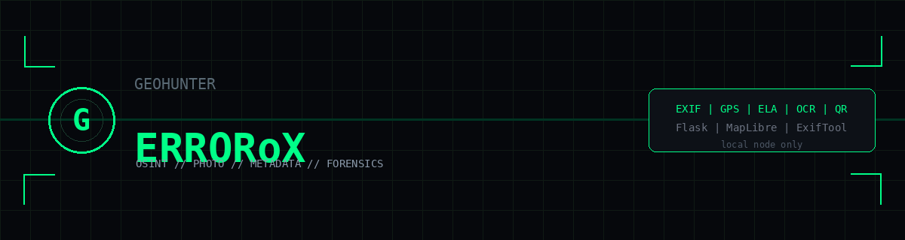
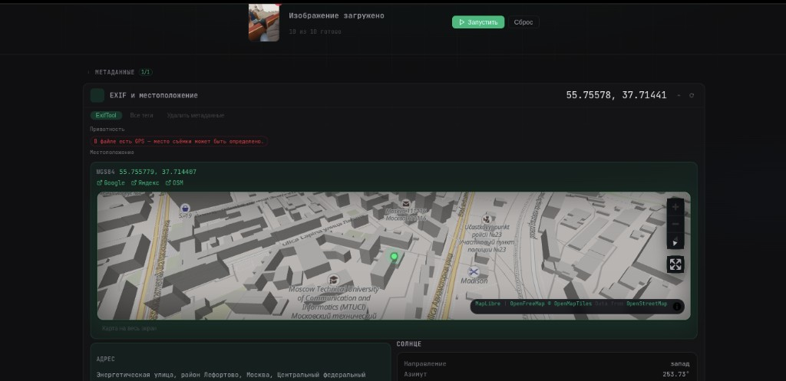
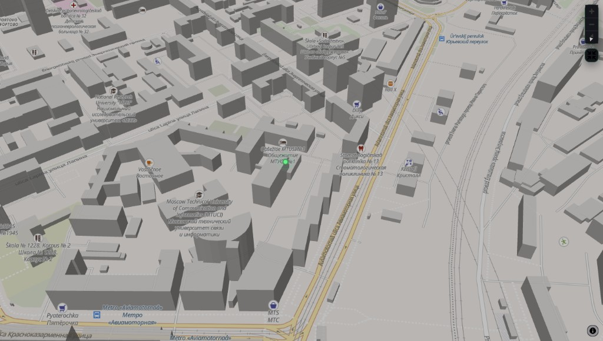
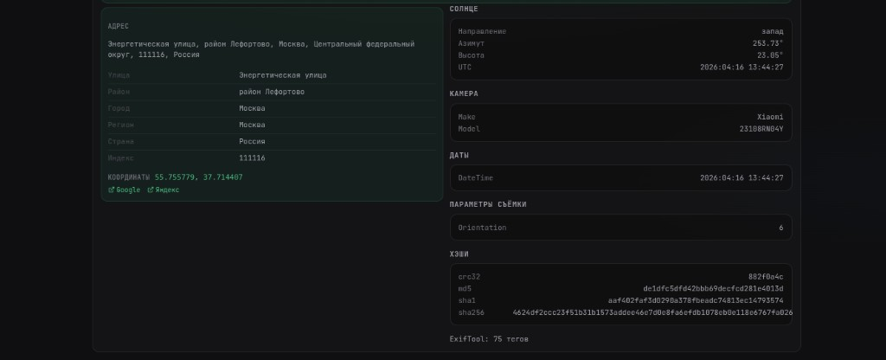
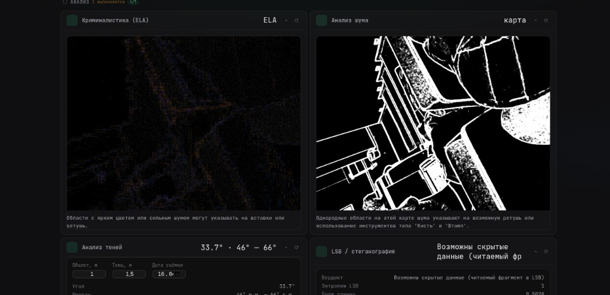

<p align="center">
  
</p>

```text
 ██████╗ ███████╗ ██████╗ ██╗  ██╗██╗   ██╗███╗   ██╗████████╗███████╗██████╗
██╔════╝ ██╔════╝██╔═══██╗██║  ██║██║   ██║████╗  ██║╚══██╔══╝██╔════╝██╔══██╗
██║  ███╗█████╗  ██║   ██║███████║██║   ██║██╔██╗ ██║   ██║   █████╗  ██████╔╝
██║   ██║██╔══╝  ██║   ██║██╔══██║██║   ██║██║╚██╗██║   ██║   ██╔══╝  ██╔══██╗
╚██████╔╝███████╗╚██████╔╝██║  ██║╚██████╔╝██║ ╚████║   ██║   ███████╗██║  ██║
 ╚═════╝ ╚══════╝ ╚═════╝ ╚═╝  ╚═╝ ╚═════╝   ╚═══╝   ╚═╝  ╚══════╝╚═╝  ╚═╝
     [ ЛОКАЛЬНЫЙ ФОТО-OSINT УЗЕЛ ] :: EXIF // ГЕО // КРИМИНАЛИСТИКА // РАЗВЕДКА
```

<h1 align="center">GeoHunter</h1>

<p align="center">
  <strong>Локальный фреймворк анализа изображений</strong><br>
  метаданные · геопривязка · криминалистика · текст · коды · обратный и веб-поиск
</p>

<p align="center">
  
  
  <a href="LICENSE"></a>
</p>

---

## /// БРИФИНГ

**GeoHunter** — самостоятельный локальный инструмент для исследования изображений. Он собирает технические сведения о файле, извлекает EXIF/GPS, отображает координаты на карте и предоставляет инструменты для криминалистического анализа, OCR, QR/штрихкодов и подготовки поисковых запросов.

Основная обработка выполняется на вашем компьютере. Однако отдельные функции обращаются к внешним сервисам: геокодирование использует Nominatim, карта загружает тайлы из сети, а обратный поиск открывает внешние поисковые системы. Поэтому не считайте приложение полностью автономным.

После запуска откройте:

```text
http://127.0.0.1:5050/photo/
```

## /// ВОЗМОЖНОСТИ

| Модуль | Назначение | Зависимости / сервисы |
|--------|------------|----------------------|
| EXIF / GPS | Метаданные, координаты WGS84, сведения о камере, геокодирование и карта | Pillow, ExifTool, Nominatim, MapLibre |
| ELA | Визуализация различий после повторного JPEG-сжатия | Pillow |
| ШУМ | Анализ распределения шума по изображению | NumPy, SciPy |
| ТЕНИ | Расчёт положения солнца и оценка по параметрам тени | Astral |
| LSB | Просмотр младших битов и возможных признаков стеганографии | Pillow |
| ЛИЦА | Детекция лиц на изображении | OpenCV |
| OCR | Извлечение текста | Tesseract, pytesseract |
| QR / ШТРИХКОДЫ | Чтение QR-кодов и штрихкодов | pyzbar, libzbar |
| ОБРАТНЫЙ ПОИСК | Подготовка переходов к поиску изображения в сторонних системах | Браузер |
| ВЕБ-ПОИСК | Формирование поисковых запросов на основе доступных данных | Браузер |

Дополнительно доступны экспорт отчёта в Markdown/JSON, очистка EXIF с сохранением копии изображения и расширенный просмотр тегов через ExifTool.

> **Важно о криминалистике:** ELA, шум, тени и LSB дают ориентиры для дальнейшей проверки, а не доказательство монтажа, подделки или авторства. На результаты влияют формат, повторное сжатие, обработка камерой и другие факторы. Не делайте выводы только по одному модулю.

## /// СКРИНШОТЫ

<p align="center"><b>01 — EXIF / GPS / КАРТА</b></p>
<p align="center">
  
  
</p>

<p align="center"><b>02 — ПАНЕЛЬ МЕТАДАННЫХ</b></p>
<p align="center">
  
</p>

<p align="center"><b>03 — КРИМИНАЛИСТИКА</b></p>
<p align="center">
  
</p>

---

## /// ТРЕБОВАНИЯ

- Python 3.10 или новее.
- Linux (рекомендуется Debian/Ubuntu/Kali), macOS или WSL.
- Для соответствующих модулей — ExifTool, Tesseract OCR и системная библиотека ZBar.
- Доступ к интернету нужен для геокодирования, загрузки карты и переходов к внешнему поиску.

## /// УСТАНОВКА · LINUX

### 1. Системные зависимости

Для Debian, Ubuntu и Kali Linux:

```bash
sudo apt update
sudo apt install -y python3 python3-venv python3-pip \
  libimage-exiftool-perl tesseract-ocr tesseract-ocr-rus \
  tesseract-ocr-eng libzbar0 libgl1
```

### 2. Клонирование и виртуальное окружение

```bash
git clone https://github.com/ERRORoX/Geohunter.git
cd Geohunter

python3 -m venv .venv
source .venv/bin/activate

python -m pip install --upgrade pip
pip install -r requirements.txt
```

### 3. Запуск

```bash
python run.py
```

Затем откройте http://127.0.0.1:5050/photo/.

Проверить наличие системных утилит можно командами:

```bash
exiftool -ver
tesseract --version
```

Если команда `python3` в терминале указывает на Python из стороннего приложения, используйте системный интерпретатор, например:

```bash
/usr/bin/python3 run.py
```

## /// НАСТРОЙКИ

Параметры приложения читаются из переменных окружения и файла `.env` через Pydantic Settings. Файл `.env.example` в репозитории не поставляется — создайте `.env` самостоятельно при необходимости.

Основные параметры:

| Переменная | Назначение | Значение по умолчанию |
|------------|------------|------------------------|
| `HOST` | Адрес интерфейса сервера | `127.0.0.1` в `run.py` |
| `PORT` | Порт сервера | `5050` |
| `FLASK_DEBUG` | Режим отладки Flask | `0` |
| `MAX_UPLOAD_MB` | Максимальный размер запроса | `16` |
| `CORS_ORIGINS` | Разрешённые CORS-origin | `*` |
| `SECRET_KEY` | Ключ подписи сессий | тестовое значение из конфигурации; замените для развёртывания |

Пример запуска с явными параметрами:

```bash
HOST=127.0.0.1 PORT=5050 FLASK_DEBUG=0 python run.py
```

Для доступа с других устройств изменяйте адрес привязки только осознанно. Не публикуйте сервис в интернете без полноценной аутентификации, HTTPS, ограничения CORS и настройки секретного ключа.

## /// РАБОЧИЙ ЦИКЛ

1. **Загрузка** — выберите локальный файл или укажите URL изображения.
2. **Анализ** — после загрузки интерфейс запускает доступные модули; отдельные инструменты можно повторно запускать из интерфейса.
3. **Проверка** — изучите EXIF/GPS, результаты OCR/QR и криминалистические индикаторы.
4. **Поиск** — при необходимости откройте подготовленные ссылки и запросы во внешнем браузере.
5. **Экспорт** — сохраните отчёт в Markdown или JSON.
6. **Очистка** — при необходимости создайте копию изображения без EXIF.

**Практические замечания:**

- Для извлечения GPS обычно нужен оригинальный файл: мессенджеры и социальные сети часто удаляют метаданные.
- Отсутствие координат в EXIF не означает, что место съёмки невозможно установить другими методами.
- Пустая карта может означать отсутствие сети или недоступность поставщика картографических тайлов.
- Ошибка HTTP 413 означает, что превышен лимит размера запроса.

## /// API

API использует JSON и, для операций с изображением, поле `imageBase64`. Основные маршруты:

| Маршрут | Назначение |
|---------|------------|
| `POST /api/exif` | Извлечение метаданных и GPS |
| `POST /api/exif/strip` | Создание изображения без EXIF |
| `POST /api/exif/exiftool/json` | Расширенный дамп ExifTool |
| `POST /api/forensics/ela` | ELA |
| `POST /api/forensics/noise` | Анализ шума |
| `POST /api/forensics/stego` | Анализ LSB |
| `POST /api/forensics/faces` | Детекция лиц |
| `POST /api/forensics/shadow-solve` | Расчёт по параметрам тени |
| `POST /api/ocr` | Распознавание текста |
| `POST /api/qr-barcode` | Чтение QR и штрихкодов |
| `POST /api/reverse-search` | Ссылки на обратный поиск |
| `POST /api/search` | Поисковые запросы |
| `POST /api/export-report` | Экспорт отчёта |
| `POST /api/export-json` | Экспорт JSON |

Пример запроса к EXIF API:

```bash
curl -s -X POST http://127.0.0.1:5050/api/exif \
  -H "Content-Type: application/json" \
  -d "{\"imageBase64\":\"$(base64 -w0 photo.jpg)\",\"exiftool\":true,\"geocode\":true}"
```

Подробности реализации и конфигурации находятся в `backend/routes.py` и `backend/config.py`.

## /// СТРУКТУРА ПРОЕКТА

```text
GeoHunter/
├── backend/              # Flask API, маршруты, сервисы и модули
│   ├── modules/           # EXIF, GPS, поиск и расчёты
│   └── tools/             # Реестр инструментов анализа
├── static/photo/         # Веб-интерфейс и JavaScript-модули
├── tools/exif_inspector/ # Расширенный просмотр EXIF
├── docs/                 # Баннер и скриншоты
├── requirements.txt
├── run.py
├── LICENSE
└── LICENSE_RU
```

Новый инструмент обычно добавляется в `backend/tools/` и регистрируется в `backend/tools/registry.py`; связанные элементы интерфейса находятся в `static/photo/js/modules/`.

## /// УСТРАНЕНИЕ НЕПОЛАДОК

| Проблема | Что проверить |
|----------|---------------|
| ExifTool не найден | Установите `libimage-exiftool-perl` или пакет для вашей ОС |
| OCR не работает | Установите Tesseract и языковые пакеты `rus` / `eng` |
| QR не читается | Проверьте наличие `libzbar0` |
| Модуль «Лица» недоступен | Проверьте установку `opencv-python-headless` |
| Карта не загружается | Проверьте соединение и доступность внешнего поставщика тайлов |
| Нет точки на карте | Проверьте наличие GPS-координат в EXIF |

При запуске GeoHunter выводит предупреждения о недоступных системных зависимостях.

## /// БЕЗОПАСНОСТЬ И КОНФИДЕНЦИАЛЬНОСТЬ

- По умолчанию сервер запускается на loopback-интерфейсе `127.0.0.1`, а режим Flask Debug выключен.
- Геокодирование может передавать координаты внешнему сервису Nominatim; карта загружает тайлы из сети.
- Обратный поиск и веб-поиск требуют перехода к сторонним сайтам.
- EXIF может содержать GPS, серийные номера устройств, временные метки и другие чувствительные сведения.
- Не загружайте чужие изображения без законного основания и не публикуйте отчёты с персональными данными без необходимости.
- Перед развёртыванием в сети задайте уникальный `SECRET_KEY`, ограничьте CORS и настройте аутентификацию и HTTPS.

## /// АВТОР И ОБРАТНАЯ СВЯЗЬ

**Автор:** ERRORoX

Сообщения об ошибках и предложения по улучшению можно оставлять во вкладке [Issues](https://github.com/ERRORoX/Geohunter/issues). При создании обращения укажите ОС, версию Python, версию ExifTool (если используется) и текст ошибки. Не прикладывайте личные фотографии, координаты, номера телефонов или другие чувствительные данные.

## /// ЛИЦЕНЗИЯ И ОТВЕТСТВЕННОСТЬ

GeoHunter распространяется по лицензии **GNU General Public License v3.0 (GPL-3.0)**. Полный текст находится в файле [LICENSE](LICENSE); русскоязычная версия — [LICENSE_RU](LICENSE_RU).

Используйте инструмент только для анализа материалов, на которые у вас есть право. Результаты модулей являются техническими индикаторами и требуют независимой проверки.

<p align="center"><b>GEOHUNTER · ERRORoX</b></p>
